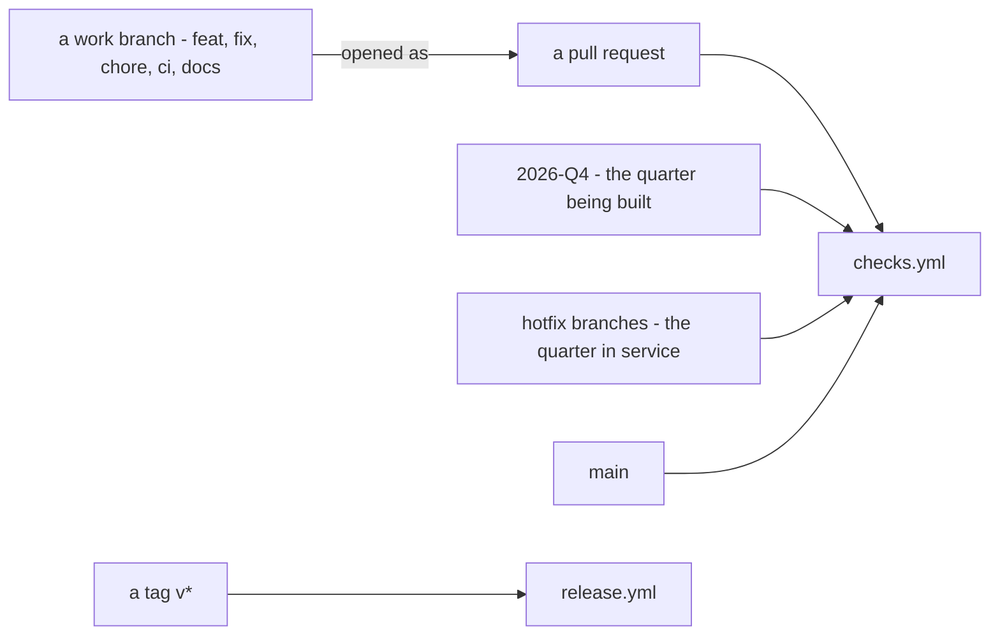

# CI and tests

What starts a GitHub Actions workflow, and what each one runs. For what each
suite actually checks, how to run it locally, and the defect behind each
invariant, see
[test/README.md](https://github.com/understand-tech/ai-in-a-box/blob/2026-Q4/test/README.md) —
this page is the trigger map, that one is the reference.

## Where checks run

| Workflow | Trigger | Runs | Takes |
|---|---|---|---|
| `checks.yml` | every pull request, and a push to `main`, `hotfix/**` or `2026-**` | `invariants.sh`, `capabilities.sh`, `migration.sh` | under a minute |
| `nightly.yml` | 3 a.m. and manual — **neither works yet**, see below | `database-restore.sh` | about a minute |
| `release.yml` | a tag matching `v*` | the checks, then a fresh install walked end to end, then the package is built, signed and published | longer |

<!-- Scope: which event starts which workflow. Not what the checks assert, and
     not a branching policy. -->
<!-- Source of truth: .github/workflows/checks.yml:3-6,
     .github/workflows/release.yml:4-7 -->
<!-- Date: 2026-10-29 -->
<!-- Target: portal — status of "flowchart": not verified, no rendering engine
     installed here; github — rendered, seen at test/README.md before this page
     took the diagram over -->

**Description** — Pushing to a work branch on its own runs nothing: the trigger
list names `main`, `hotfix/**` and `2026-**`, and no other branch. What gets a
work branch checked is **opening a pull request**, which runs `checks.yml`
whatever the branch is called. Pushes to the three named branches run the same
workflow, so a merge is checked again on arrival. A tag matching `v*` is the
only thing that starts `release.yml`, which re-runs the checks, walks a fresh
install, then builds and publishes the release — see
[building and publishing a release](releasing.md) for what that stage does.

**Gaps** — The diagram shows what starts a workflow, not how branches merge
into one another: that is a convention, not something this repository declares.
`nightly.yml` is absent because neither of its triggers works yet, as below.
Not verified: not seen rendered — no Mermaid engine is installed here.

## Why the nightly check does not run on its own

`gh workflow run nightly.yml` does not work, and it is not a local problem:
GitHub only reads `schedule` and `workflow_dispatch` from the repository's
**default branch**, and `nightly.yml` lives on the release branches, not on
`main` — so neither the 3 a.m. cron nor the *Run workflow* button is armed.
`checks.yml` is unaffected, because `push` and `pull_request` are evaluated on
the branch being pushed, not on the default branch.

Until that is resolved, `database-restore.sh` is run by hand — see
[test/README.md](https://github.com/understand-tech/ai-in-a-box/blob/2026-Q4/test/README.md#running-the-nightly-check).

## Running the suites locally

Covered in [test/README.md](https://github.com/understand-tech/ai-in-a-box/blob/2026-Q4/test/README.md):
which script needs Docker, which one needs the full git history, filtering one
capability or one property, and what each check actually catches. Repeated here
only as an index, from the project's own `CLAUDE.md`:

| Suite | Needs | Roughly |
|---|---|---|
| `invariants.sh` | nothing — bash and coreutils | under a second |
| `capabilities.sh` | Docker | ~5 min, or ~17 s filtered with `CAPABILITY_FILTER` |
| `fresh-install.sh` | Docker | ~2 min, filtrable with `PROPERTY_FILTER` |
| `ingress.sh` | Docker, public images only | ~1 min — the only suite that reaches a running service |
| `discrimination.sh` | Docker | several minutes — run it when a check changes |
| `migration.sh` | Docker, full git history | ~1 min, `MIGRATION_FROM` to set |
| `migration-on-data.sh` | Docker, private images | long, manual — not without a precise reason |

## What this document does not cover

What each `check_*` function in `invariants.sh` asserts, and the defect it was
written for — both are in
[test/README.md](https://github.com/understand-tech/ai-in-a-box/blob/2026-Q4/test/README.md#what-it-is-for).
How a pull request is reviewed is not a testing question — see the project's own
conventions for that.
