# Installing

From a machine with nothing on it to a running appliance. Safe to interrupt and
safe to re-run: every step checks its own state before acting, so an install
that stopped halfway is resumed by running the same command again.

## What `ut-install` does, in order

```mermaid
flowchart LR
    PREFLIGHT["preflight - refuses a machine that cannot run it"]
    ASK["ask the address and the license key, activate or check the license"]
    FETCH["sign in to the registry, fetch the release"]
    CONFIGURE["write .env and generate every secret"]
    RESOLVE["check the address resolves, and the docker group"]
    CA["create the networks"]
    PULL["pull the images"]
    START["start, then wait for every service to be healthy"]
    PERSIST["boot service, usage reports"]
    PREFLIGHT --> ASK --> FETCH --> CONFIGURE --> RESOLVE
    RESOLVE --> CA --> PULL --> START --> PERSIST
```

<!-- Scope: the order of the installer's steps. Not what each one checks. -->
<!-- Source of truth: ut-install, main() -->
<!-- Date: 2026-10-20 -->
<!-- Target: github — status of "flowchart": rendered -->



**Description** — The installer runs nine stages in a fixed order, and stops at
the first one that fails. It begins with a preflight that refuses a machine
that cannot run the stack, **before writing anything**. It then asks for the
address the platform answers on and for the license key. On a first install it
activates the license with Keygen, which needs the network once; later it checks
the license file this machine keeps, with no network. It signs in to the
registry with the access the license carries — skipped with `--skip-pull` — and
fetches the release, writes
`/etc/understandtech/.env` and generates every secret, checks that the address
resolves and that Docker is usable, creates the networks, pulls the images,
starts the stack and waits for every service to report healthy. It ends by
installing the boot service and asking whether usage reports go out.
Nothing is left running if an earlier stage failed.

**Gaps** — Nine boxes, not one per internal step: the address and the license
are one box, as are the registry sign-in and the fetch, the address check and
the Docker group, and the boot service and the usage reports. The diagram does
not show what each stage checks or what it does when it finds the work already
done. Not verified: the diagram has not been seen rendered — no rendering
engine is installed here.

## What you need first

- A machine with Docker 24 or newer and Compose v2, 250 GB free, 24 GB of RAM.
- The license key UnderstandTech issued for the machine. The first install
  activates it through `api.keygen.sh`; a machine that cannot reach it gets its
  license file from UnderstandTech instead, as section 5 says.
- The address the appliance will answer on. Not `understand.local` unless the
  machine really is on a flat local network — see
  [certificates and DNS](certificates-and-dns.md).

## In one command

```bash
VERSION=2026.09.1
curl -fsSLO "https://github.com/understand-tech/ai-in-a-box/releases/download/v${VERSION}/ut-get"
sudo bash ut-get --version "$VERSION" --domain box.example.com
```

`ut-get` downloads the package and its signature into
`/var/cache/understandtech/releases/<version>/`, checks the signature with the
key it carries — the same key as `ut-verify` — installs the package with
`apt-get`, then runs `ut-install` with every option it does not use itself, here
`--domain`. `ut-install` runs the checks of step 4 on its own, so what follows is
step 5. Nothing is installed from a package it cannot verify.

- A download that stops resumes when the same command is run again, and a
  release already downloaded installs again with no network.
- Without `--version`, it takes the latest release. A pre-release — a version
  with a suffix, such as `2026.10.0-rc3` — is never the latest, so installing one
  takes `--version`.
- A machine with no network: on any connected Linux or macOS machine with Docker
  and `jq`, prepare a folder with the release, every image it runs and the
  weights of its models —
  `bash ut-get --prepare <folder> --version "$VERSION" --license-file license.key`,
  with `--model <id>` for a model other than the release's, and the engine it
  runs on when that is not NIM,
  `--architecture amd64` for an x86 control plane, and `--role compute` or
  `--role control-plane` to carry only what a compute node or a control plane
  taking its inference elsewhere runs — a compute node's folder leaves the
  platform out, about 40 GB less; run again to resume. A folder prepared for
  one role is refused on a box installed as another; one prepared without
  `--role` serves every role. The
  license key reads its registry access from Keygen. Carry the folder to the
  box, then
  `sudo bash ut-get --from <folder> --license-file license.key --domain box.example.com`.
  The box checks each image and each weight file against the signed release
  before using it, and downloads nothing. A model goes in a folder once its
  license has been read and its weights pinned in `models/weights/`; the
  preparation names the ones that are not. The box's license still needs Keygen
  once: a box that cannot reach it writes a request, as section 5 says. Put the
  license file UnderstandTech sends back into the folder, and run `ut-get --from`
  again. Once the package is installed, `ut-get` is also at `/usr/bin/ut-get`.
- Releases published before `ut-get` existed do not carry it. Install those by
  the steps below.

### From a browser on the box

On a box with a screen and a desktop session, `--browser` hands over to
`ut-setup` instead of `ut-install`. A page shows what `ut-install --check` found,
then asks the questions one per screen — the address, the license key, the model
among those `ut-install --list-models` shows proven on this GPU, and usage
reports:

```bash
sudo bash ut-get --version "$VERSION" --browser
```

`ut-setup` opens the desktop's browser on `http://127.0.0.1:<port>/?code=<code>`
and prints that address too. It listens on the box only. The code works once,
for one browser, and five wrong codes stop it. The page runs `ut-install` with
your answers, shows each step and each image as it lands, then the two
passwords, once. Then `ut-setup` stops. Give it no `ut-install` option: the page
asks for them. On a box already installed, `sudo ut-setup` does the same.

A box with no network goes through the page too, from its prepared folder:

```bash
sudo bash ut-get --from <folder> --browser
```

The images come from the folder, and so does the license when the folder holds
the license file UnderstandTech sent: the page then asks for no key. It asks
nothing about usage reports either — a box with no network sends none. A folder
prepared for another role, release or processor is refused on the first screen,
before any question.

### From your own machine, through SSH

The page listens on the box only, so reach it through an SSH tunnel. On the
box, over SSH:

```bash
sudo bash ut-get --version "$VERSION" --browser
```

On a box already installed, `sudo ut-setup` is enough. Either prints `http://127.0.0.1:<port>/?code=<code>`. On your own machine, in a
second terminal, with that port:

```bash
ssh -N -L <port>:127.0.0.1:<port> <user>@<box>
```

Then open the printed address in your browser and press **Continue**. Keep the
tunnel open until the page shows the two passwords.

`ut-get` itself comes from GitHub over HTTPS and nothing checks it before it
runs. To check every file before running anything, follow the steps below
instead.

## 1 · Get the release

Releases are published at
`https://github.com/understand-tech/ai-in-a-box/releases`. **Take all seven
files**, not just the package:

```bash
VERSION=2026.09.1
BASE=https://github.com/understand-tech/ai-in-a-box/releases/download/v$VERSION

mkdir ut-release && cd ut-release
for f in understandtech_${VERSION}_all.deb understandtech_${VERSION}_all.deb.sig \
         understandtech_${VERSION}.cdx.json \
         ut-verify ut-get release.pub SHA256SUMS; do
    curl -fsSLO "$BASE/$f"
done
chmod +x ut-verify
```

`SHA256SUMS` lists all six of the others, so downloading fewer makes the next
command report a failure on a release that is perfectly sound.

`understandtech_${VERSION}.cdx.json` is the bill of materials: every image this
version runs, named by its digest rather than by a tag a registry can repoint.
Nothing needs it to install — it is there for whoever has to answer what is
running on the machine.

## 2 · Check it before you install it

```bash
sha256sum -c SHA256SUMS
./ut-verify understandtech_${VERSION}_all.deb
```

Expect six `OK` lines, then:

```
[ ok ] understandtech_2026.09.1_all.deb is signed by UnderstandTech
```

**This step is not a formality.** `dpkg` ships with `no-debsig`, so it installs
a local file without checking any signature at all — a package carried in on a
USB stick is verified by nothing unless you verify it. `ut-verify` needs
`openssl` and no network, and it refuses a package that was altered, signed by
another key, or not signed.

`./ut-verify --fingerprint` prints the key it carries. Compare it with the
fingerprint published out of band — on the contract or the website — the first
time you install on a site.

## 3 · Install the package

```bash
sudo apt-get install ./understandtech_${VERSION}_all.deb
```

`apt-get install ./file.deb` rather than `dpkg -i`: it pulls in `openssl` if the
machine lacks it.

Nothing starts. The package places files and tells you what to run next.

## 4 · Look before you touch anything

```bash
sudo ut-install --check
```

Changes nothing. It reports Docker's version, whether the GPU is reachable from
containers, free disk, RAM, the clock, and whether the address resolves. Every
problem it names is one you would otherwise meet halfway through, with services
already running.

**The clock is checked against the release's own build date.** Offline there is
no authority to ask, but a package cannot have been built after the machine
installing it — so a clock earlier than the release is wrong, and every
certificate issued on it would be refused as not yet valid. On a machine with no
network, set the clock by hand before installing.

The GPU check accepts either mechanism — the legacy `nvidia` docker runtime, or
CDI device files under `/etc/cdi` and `/var/run/cdi`. Recent NVIDIA toolkits
register no docker runtime at all, so a working machine can have none.

### A machine that serves no inference

A machine whose inference comes from elsewhere has no accelerator to find, and
saying so lets the install go on:

```bash
sudo ut-install --check --no-gpu
```

A settings file already carrying `compose.no-gpu.yaml` in `COMPOSE_FILE` says the
same thing, so a laboratory stack set up as described below needs no flag.

Two things follow from the declaration, and only from it:

- **The accelerator check becomes a warning.** It is waived on the *absence* of
  an accelerator, never on a broken one: a machine where `nvidia-smi` answers but
  Docker cannot reach the GPU is still refused, flag or no flag. A driver that
  stopped answering after a kernel upgrade looks exactly like a machine that
  never had one, and the second must not cover for the first.
- **The disk and memory floors follow.** 60 GB instead of 250, 12 GB of RAM
  instead of 24. The engines and their weights account for most of what an
  appliance stores, and a machine that runs none of them will never use it.

Nothing else changes. The install still writes the same configuration, issues the
same certificates and installs the same units. `VLLM_LLM_BASE_URL` has to name a
machine that does generate, or the platform comes up answering nothing.

**Chats over documents need a GPU here too.** They go through `llm`, which
searches the documents and reranks them before asking the engine, and `llm` does
not start without an accelerator: its build of llama.cpp loads CUDA when it
starts. `--no-gpu` therefore leaves a platform that answers plain chats from the
other machine and nothing over documents, and the install says so.

When the other machine is a compute node, `--inference-from` says so: it sets the
address, the node's key and the trust in its root in one go — see
[adding a second machine](certificates-and-dns.md#adding-a-second-machine). No
engine starts here. A machine with a GPU keeps it for `llm`; one without is
installed as with `--no-gpu`. The compute node itself is installed with
`sudo ut-install --compute <its IP or DNS name>`; neither side takes a `.local`
name for the other.

The summary printed at the end names the role the machine was installed as, and
it is kept in the install log.

## 5 · Configure and start

```bash
sudo ut-install --domain box.example.com
```

It asks for the license key, or reads it from `--license-file`, or takes it from
`UT_LICENSE`, right after the preflight and before anything is written or
downloaded. The key is kept in `/etc/understandtech/license`, readable by root
only, so an update does not ask again.

A license binds to one machine. On the first install, `ut-install` activates it
with Keygen under this machine's fingerprint, taken from its serial number, and
keeps the license file Keygen signs for it in `/etc/understandtech/machine.lic`,
readable by root only. Every later run checks that file first, with no network:

- a file that was altered, signed by another key, or made for another machine
  stops the run there, before anything goes on the network;
- a clock set before the day the file was issued is named as such: set the clock;
- a file that has ended, or whose license has ended or is suspended, is asked
  again from Keygen, which says whether the license was renewed.

A license already activated on another machine is refused: ask UnderstandTech to
release it. A key of the old format, `UT1.…`, is refused too: ask for a new one.
The registry access the license carries is never passed on a command line and
never written to the log.

**A machine that cannot reach Keygen** is activated by a file exchange:

1. `ut-install` stops, and writes `/etc/understandtech/license-request.json`: the
   machine's fingerprint and name, never the license key. It prints it too, as a
   QR code when `qrencode` is installed.
2. Send that file to UnderstandTech. The license file that comes back works on
   this machine only, for a year.
3. Run the install again with it, and the images already on the machine:

   ```bash
   sudo ut-install --license-file license.key --machine-file box.lic --skip-pull
   ```

   or, with a prepared folder, put the file into it and run `ut-get --from`
   again: it hands the folder's only `.lic` file to `ut-install`. The file is
   checked with no network, then kept like one Keygen handed over.

The license also names the registry the images come from. For any registry but
`ghcr.io`, every image of the release is pulled from it — ours and the third-party
ones alike — under the path it has upstream (`library/caddy` for Docker Hub's
`caddy`), with the same digest.

A license that has ended stops an install or an update, and says on which day.
It never stops a platform that is running: at every boot the service writes the
end date to the journal (`journalctl -u understandtech`) and starts the stack
anyway. To see what the license file says without installing:

```bash
sudo ut-license check /etc/understandtech/machine.lic
```

A registry token on its own, with `--token-file` or `UT_REGISTRY_TOKEN`, is still
accepted by this version, with a warning. The next version asks for a license
key.

**Leave `--domain` out and it asks.** Answering nothing on a first install takes
`understand.local`, which resolves over mDNS on one flat network and nowhere
else, and which no public authority will certify — so every machine that uses
the appliance then has to install a root certificate by hand. An unattended run
with no terminal to ask on takes the same fallback and says so in the log.

The address also decides what gets set up: the mDNS publisher is installed only
for a `.local` name. On your own domain nothing is published here and Avahi is
not needed — the six names come from your zone.

What it does, in order: writes `/etc/understandtech/.env`, **generates every
secret**, checks the address resolves, creates the networks, pulls the images,
starts the stack, waits for the platform to be healthy, and installs the boot
service.

The images are the long part, several tens of GB on a first install. Each one is
named as it lands, with how many there are and the minutes since the download
began:

```text
     7/13  ghcr.io/understand-tech/api:2.1-arm64@sha256:…  (12 min)
```

**It hands back as soon as the platform answers**, usually within a minute of
the images being on the machine. The inference engines keep loading their model
weights in the background — up to 45 minutes on a first install — and the
installer says so, with the command to follow them. Sign in and configure while
they load.

Follow them with `sudo docker compose ps` in `/usr/share/understandtech`. It
needs `sudo`: the settings file it reads is `0600`.

## 6 · Write down what it prints at the end

The last screen opens on how long the install took and the address to open
first: the initial admin password opens the
[first-run wizard](first-run-configuration.md) there. An inference engine still
loading is named on an `Inference` line.

Two secrets are shown **once**, on the terminal and not in the log:

- the **initial admin password**;
- the **backup password** (`BACKUP_FILES_PASSWORD`).

Losing the backup password makes every snapshot unreadable — including the
remote ones, including the certificate authority's root. There is no recovery
path. Put it wherever your organisation keeps such things before closing the
terminal.

## 7 · Verify

```bash
sudo ut-status
```

It reports every service, asks each public surface on this machine, says where
the inference comes from, and until when the license runs. It exits non-zero when
a service is unhealthy or a surface does not answer, so it can be called from cron
or a check. A license that has ended is a warning, never a failure: the platform
serves until the next update, which asks Keygen for the renewed license, or
refuses it.

Every verdict is kept in `install-history.jsonl` under `DATA_ROOT`, with the
machine's available memory at that moment, beside one line for every run of
`ut-install`, failed runs included and named by the step they stopped at. Read
together, they say whether an install served the first time, or only after being
run again. `ut-install` also schedules `ut-status`
every hour, so the history does not depend on someone running it. Without
`sudo` the verdict is shown and not kept, and `ut-status` says so.

```text
==> Services
[ ok ] every service is healthy or running

==> Surfaces, asked on this machine
[ ok ] https://box.example/
[ ok ] https://admin.box.example/
...

[ ok ] The install is serving on https://box.example
```

Then open `https://<your-domain>` and sign in with the admin password.

In the default TLS mode the browser warns on first visit: the certificate is
signed by an authority only this machine knows. That is expected — see
[certificates and DNS](certificates-and-dns.md) to make the warning go away, and
`ut-certificate` to obtain a publicly trusted one.

## Where things go

| Path | Holds | On upgrade |
|---|---|---|
| `/usr/share/understandtech/` | compose files, Caddy configuration | replaced |
| `/etc/understandtech/` | `.env` — your address, ports and secrets | **never touched** |
| `/var/lib/understandtech/` | databases, documents, the install history | untouched, kept even on removal |
| `/usr/bin/ut-*` | the tools | replaced |

`.env` is generated by `ut-install`, so it is not part of the package and an
upgrade has nothing to overwrite. Compose reads it through a link from the
release directory, which therefore holds no state of its own.

**`/var/lib/understandtech` is what a backup must cover.** The rest is
reinstallable in a minute.

## Useful options

| Option | When |
|---|---|
| `--check` | Before anything. Changes nothing. |
| `--domain NAME` | The address the platform answers on. Asked for when omitted. |
| `--license-file PATH` | Read the license key from a file instead of a prompt. |
| `--token-file PATH` | A registry token instead of a license key. This version only. |
| `--machine-file PATH` | The license file UnderstandTech sent for a machine that cannot reach Keygen. Checked with no network, then kept. |
| `--skip-pull` | Images are already on the machine. The license file this machine keeps is still checked; the registry is not contacted. A first install activates the license through Keygen, or takes `--machine-file`. |
| `--no-autostart` | Do not install the boot service. |
| `--dir PATH` | Another release directory. Defaults to `/usr/share/understandtech`. |
| `--health-timeout N` | Longer than 3600 s if the machine is slow to load models. |

## If it stops

It says which step and which line. Nothing is rolled back, and the same command
resumes from there. The full log is at `/var/log/ut-install.log`.

Three failures account for almost all of them — the GPU not reachable from
containers, Docker out of address space, and an address that does not resolve.
Each one, with what to do about it, is in
[when it breaks](when-it-breaks.md#during-an-install).

## Installing beside something already running

A test install next to a live one needs its own names, its own directory, its
own data root and its own ports. Take a copy of the release directory rather
than the packaged one, so the package can be upgraded without disturbing it:

```bash
cp -r /usr/share/understandtech ~/ut-lab
cd ~/ut-lab
```

Then in `~/ut-lab/.env`:

```bash
COMPOSE_PROJECT_NAME="lab"
RESOURCE_PREFIX="lab"
CONTAINER_PREFIX="lab"
DATA_ROOT="/var/lib/ut-lab"
COMPOSE_FILE="compose.yaml:compose.no-gpu.yaml"
COMPOSE_PROFILES=""
UT_HTTP_PORT="8180"
UT_HTTPS_PORT="8543"
```

```bash
sudo ut-install --dir ~/ut-lab --domain lab.example.test --no-autostart
```

Four things there are not optional:

- **`COMPOSE_PROJECT_NAME`** — three services carry no fixed container name, and
  Compose names those after the project. Setting only the prefixes leaves them
  colliding.
- **`--no-autostart`** — the boot service is a system-wide unit. Installing it
  from a second directory repoints the one that starts the live stack, and the
  next reboot brings up the wrong one.
- **`compose.no-gpu.yaml` with no profiles** — `llm` requests a GPU even when
  the inference engines are switched off, and two stacks competing for the same
  device is how both end up failing.
- **A different address** — two Caddy instances claiming the same name resolve
  unpredictably.

Before starting it, check what the configuration really names:

```bash
docker compose config | grep -E '^ *(container_name|name): ut-'
```

Anything printed there belongs to the live stack. Expect no output.
