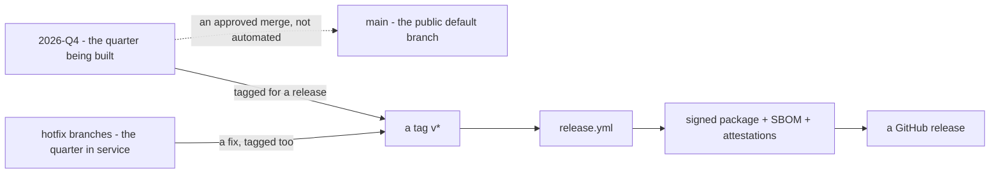

# Building and publishing a release

A release is a signed Debian package plus a bill of materials, built from a
tag by `.github/workflows/release.yml`. This page covers how a tag becomes a
published release and what pins it to an exact, reproducible set of images —
not how to install one, which is [installing](install.md).

## Branches and tags

<!-- Scope: branch roles and what moves a change from one to a tag. Not a
     review policy, not who is allowed to tag. -->
<!-- Source of truth: .github/workflows/checks.yml:3-6,
     .github/workflows/release.yml:4-7, git tag history (v2026.* and -rc*) -->
<!-- Date: 2026-10-29 -->
<!-- Target: portal — status of "flowchart": not verified, no rendering engine
     installed here. -->



**Description** — `2026-Q4` is the branch the product is actually built on;
`hotfix/**` branches carry fixes for the quarter already in service. Both are
tagged directly to cut a release — a tag matching `v*` is the only thing that
starts `release.yml`, on whichever branch carries it. `main` is the
repository's public default branch and receives `2026-Q4` only through an
approved merge, on no fixed schedule; `checks.yml` still runs on pushes to
`main`, `hotfix/**` and `2026-**`, so a merge is checked again on arrival. See
[CI and tests](ci-and-tests.md) for what runs on a pull request versus a tag.

**Gaps** — Not drawn: how `hotfix/**` branches are created from the quarter in
service, or who approves a merge to `main`. Not verified: not seen rendered —
no Mermaid engine is installed here.

A tag with a suffix, such as `v2026.10.0-rc3`, is a pre-release candidate: it
is published but never shown as *Latest*, and installing one by version
requires naming it explicitly — see
[installing, without `--version`](install.md#in-one-command).

## What a tag publishes

In order, on `ubuntu-24.04`:

1. **The checks run again.** `invariants.sh`, `capabilities.sh`, then a fresh
   install walked end to end with `fresh-install.sh` — a release that fails its
   own checks is worse than no release, since it is installed before anyone
   notices.
2. **`ut-send` is built** for arm64 and amd64 (`packaging/build-ut-send.sh`),
   and **`ut-arbiter` is fetched** for both architectures from its own
   repository and pipeline — private, so it is pulled with a dedicated
   read-only token and pinned here by checksum rather than built from source.
3. **The package is built** — `packaging/build-deb.sh "$VERSION"` — with
   `SOURCE_DATE_EPOCH` fixed to the tagged commit's own date, so the same tag
   rebuilt elsewhere produces the same bytes.
4. **It is signed**: `openssl dgst -sha256 -sign` with `RELEASE_SIGNING_KEY`
   (ECDSA P-256), kept in the workflow's secrets, never in the repository.
5. **The signature is verified immediately**, with `./bin/ut-verify`, against
   the public key the package itself ships — a mismatched key is caught here,
   not on a customer's offline machine.
6. **What was built is attested**: a GitHub build-provenance attestation ties
   the package to this exact workflow run and commit, independent of
   UnderstandTech's own signing key.
7. **The bill of materials is written** — `packaging/release-bom.sh "$VERSION"`
   — as a CycloneDX document. The package itself holds shell and
   configuration, so it names one component: the appliance. What the appliance
   is actually made of is the thirteen images `release.env` pins by digest; the
   script reads only `release.env`, no registry and no pull. It is attested
   too, alongside the package.
8. **Checksums**: `sha256sum` over the package, its signature, the bill of
   materials, `ut-verify`, `ut-get` and `release.pub`, written to
   `SHA256SUMS`.
9. **Publish**: `gh release create` on the tag, titled with the version,
   marked a pre-release when the version carries a suffix, with all seven
   files attached. What they are and how to check them before installing is in
   [installing — get the release](install.md#1--get-the-release) and
   [check it before you install it](install.md#2--check-it-before-you-install-it).

## Image pinning

`release.env` names every image as `repository:tag@sha256:digest`, never a
bare tag — a tag can move, a digest cannot, and two boxes reporting the same
version must be running the same software for a diagnosis on one to transfer
to the other. `packaging/pin-images.sh` rewrites `release.env` to the digest
each tag resolves to today; `packaging/pin-images.sh --check` reports any
image that is not pinned, or pinned to a digest the tag no longer resolves to,
without changing anything. It is a tool run on this repository before cutting
a release, not a step `release.yml` runs itself.

## Verifying what was published

```bash
gh attestation verify understandtech_<version>_all.deb \
    --owner understand-tech
sha256sum -c SHA256SUMS
./ut-verify understandtech_<version>_all.deb
```

The first ties the file to the exact workflow run and commit that built it,
independent of UnderstandTech's own key; the other two are the same checks an
installer runs — see
[check it before you install it](install.md#2--check-it-before-you-install-it).

## What this document does not cover

Who approves a merge from `2026-Q4` into `main`, or when a tag is cut — both
are manual, approved decisions, not something this repository automates or
enforces. `nightly.yml`'s broken triggers are covered in
[CI and tests](ci-and-tests.md#why-the-nightly-check-does-not-run-on-its-own).
