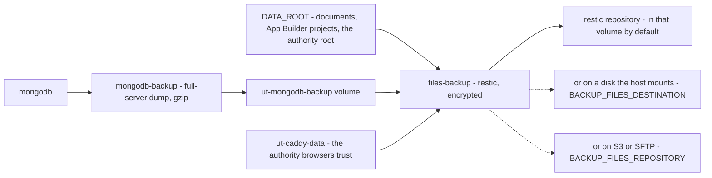

# Restoring

Three things can be restored independently: the database, the customer's files,
and the certificate authorities. Each has its own archive and its own command.

Every procedure below has been run end to end. Where a step says what to expect,
that is what it actually printed.

## What is backed up, and where it goes

<!-- Scope: what the two backup services produce, and what a restore reads.
     Not the retention rules. -->
<!-- Source of truth: compose.yaml:213-298, compose.backup-mount.yaml, compose.backup-network.yaml -->
<!-- Date: 2026-10-13 -->
<!-- Target: github — status of "flowchart": rendered -->



**Description** — Two services, in a chain. `mongodb-backup` takes a full-server
dump of every database, compressed with gzip, and writes it into the
`ut-mongodb-backup` volume. `files-backup` then reads three things — that
volume; `DATA_ROOT` on the host, which holds uploaded documents, the App
Builder's projects and step-ca's root; and, in `ut-caddy-data`, the authority
that signs the HTTPS certificate browsers see — and writes them into a `restic`
repository, encrypted with `BACKUP_FILES_PASSWORD`. By default the repository
sits in the same volume as the archives. The two dotted lines are the ways off
the machine, one at a time: a disk the host mounts — a NAS share or a USB disk —
named by `BACKUP_FILES_DESTINATION`, or an S3 bucket or an SFTP server named by
`BACKUP_FILES_REPOSITORY`. So the database leaves the site inside the file
backup, not on its own.

**Gaps** — The diagram does not show schedules or retention: the dump runs on
`BACKUP_BEGIN` / `BACKUP_INTERVAL`, the file snapshot on `BACKUP_FILES_AT`, and
retention is set by the three `BACKUP_FILES_KEEP_*` values — all in
[configuration](configuration.md). It also does not show the restore path,
which is the rest of this document and is not symmetric with the backup path.
Not verified: the diagram has not been seen rendered — no rendering engine is
installed here.

> **Losing `BACKUP_FILES_PASSWORD` makes every snapshot unreadable**, including
> the offsite ones and including the authority's root. There is no recovery
> path. It is one of the two secrets `ut-install` prints once at the end.

## Before anything else

**Do not restore over a running stack.** A restore into a database being written
to leaves a mixture of both states, and no error says so.

```bash
cd /usr/share/understandtech
docker compose stop api api-customer workers workers-customer llm
```

Leave `mongodb` running — the restore talks to it.

Write down what you are restoring *from*. `restic` and `mongodump` both keep
several snapshots, and picking yesterday's when you meant last week's is the
mistake that costs a second outage.

## 1 · The database

Archives are written daily by `ut-mongodb-backup` into the `ut-mongodb-backup`
volume, mounted at `/backup`.

**List what you have.**

```bash
docker exec ut-mongodb-backup sh -c 'ls -lt /backup/*.archive.gz' | head
```

**Check the archive is intact** — the backup container writes a checksum beside
each one.

```bash
ARCHIVE=$(docker exec ut-mongodb-backup sh -c 'ls -t /backup/*.archive.gz | head -1')
docker exec ut-mongodb-backup sh -c "cd /backup && md5sum -c '$(basename "$ARCHIVE").md5'"
```

Expect `OK`. A mismatch means that archive is unusable — take the previous one.

**Restore it.**

```bash
docker exec ut-mongodb-backup sh -c "cat '$ARCHIVE'" > /tmp/restore.gz
docker cp /tmp/restore.gz ut-mongodb:/tmp/restore.gz
rm -f /tmp/restore.gz

docker exec ut-mongodb mongorestore --gzip --archive=/tmp/restore.gz \
    -u "$USER" -p "$PASSWORD" --authenticationDatabase admin --drop
```

`$USER` and `$PASSWORD` are `MONGODB_USERNAME` and `MONGODB_PASSWORD` from
`/etc/understandtech/.env`.

`--drop` replaces each collection as it is restored. Without it, restoring onto
a database that still holds documents merges the two.

**To restore one database only**, rather than all of them:

```bash
docker exec ut-mongodb mongorestore --gzip --archive=/tmp/restore.gz \
    --nsInclude='ut-app-llms.*' -u "$USER" -p "$PASSWORD" \
    --authenticationDatabase admin --drop
```

**Verify.** Compare what came back with what the archive held:

```bash
docker exec ut-mongodb mongosh --quiet -u "$USER" -p "$PASSWORD" \
    --authenticationDatabase admin --eval '
    db.adminCommand("listDatabases").databases
      .filter(d => !["admin","local","config"].includes(d.name))
      .map(d => d.name + ":" + db.getSiblingDB(d.name).getCollectionNames().length)
      .sort().join(" ")'
```

A healthy appliance prints five databases. `test/database-restore.sh` performs
this whole cycle against a throwaway database, and compares document counts per
collection — run it if you want the mechanism checked before trusting it with
real data.

## 2 · The customer's files

Documents live under `DATA_ROOT` (`/var/lib/understandtech` by default) and are
backed up by `restic` into the same volume, at `/backup/restic`.

**List the snapshots.**

```bash
docker exec ut-files-backup restic snapshots
```

**Restore the latest one**, into a staging directory rather than over the live
one:

```bash
docker exec ut-files-backup restic restore latest --target /tmp/restored
docker exec ut-files-backup ls /tmp/restored/data
```

Compare, then move what you need into place. Restoring straight over `/data`
would be quicker and gives you nothing to compare against if it goes wrong.

**To restore a single path:**

```bash
docker exec ut-files-backup restic restore latest \
    --target /tmp/restored --include /data/app-data
```

**If the whole machine is gone**, point `restic` at the repository from
anywhere. From a local copy of the volume:

```bash
docker run --rm -v /path/to/repository:/backup -v /somewhere:/out \
    -e RESTIC_REPOSITORY=/backup/restic -e RESTIC_PASSWORD='...' \
    restic/restic:0.18.1 restore latest --target /out
```

Or straight from the offsite destination, with nothing of the appliance left:

```bash
docker run --rm -v /somewhere:/out \
    -e RESTIC_REPOSITORY='s3:https://s3.eu-west-3.amazonaws.com/your-bucket/appliance' \
    -e RESTIC_PASSWORD='...' \
    -e AWS_ACCESS_KEY_ID='...' -e AWS_SECRET_ACCESS_KEY='...' \
    restic/restic:0.18.1 restore latest --target /out
```

That second form is exercised on every push: a backup sent to an S3 endpoint,
then restored from that endpoint alone, compared path by path and checksum by
checksum — the authority's root included.

`RESTIC_PASSWORD` is `BACKUP_FILES_PASSWORD` from `.env`. **Without it the
snapshots cannot be read at all** — no support path, no recovery. It is printed
once at install time and stored nowhere else.

## 3 · The certificate authorities

The appliance runs two, and the file backup carries both.

**The one browsers trust** signs the HTTPS certificate of every name the
appliance serves, when it issues its own (`UT_INGRESS_MODE="internal"`). Caddy
keeps it in the `ut-caddy-data` volume, under `caddy/pki/authorities/local`; the
backup reads it from there. It is the root your users' machines imported. With a
certificate of your own, or behind your load balancer, browsers trust your
authority instead, and this one signs nothing they see.

**The one machines trust**, step-ca, lives at `${DATA_ROOT}/ca`. Restoring the
files restores it.

**After a restore, check the root is the one you had:**

```bash
docker exec ut-step-ca step certificate inspect /home/step/certs/root_ca.crt --short
```

If the fingerprint matches what the appliance used before, every certificate it
ever issued is still valid and every machine renews as usual. If it does not,
the authority is a new one and anything enrolled against the old one has to be
enrolled again.

`test/machine-identity.sh` proves this cycle: back up the root, erase it,
restart the authority on the restore, and renew a certificate issued before the
failure.

## 4 · Start again

```bash
cd /usr/share/understandtech
docker compose up -d
docker compose ps
```

Wait for every service to read `healthy`. Then open the platform and check one
document you know the content of — a service that starts is not a service that
kept its data.

## On another machine

When the machine is gone, its backup comes back on another one installed
afresh. What it takes: the disk the backup went to, and `BACKUP_FILES_PASSWORD`.
Nothing of the old appliance.

**1 · Install the same version, under the same address.** The address is in
the links users kept and in the sign-on settings the database carries, so
another one breaks both.

```bash
sudo ut-install --domain box.example.com
```

It generates new secrets, and this machine keeps them: what comes from the old
one is the data, never its accounts. Everyone signs in again afterwards.

**2 · Mount the backup disk, and read the latest snapshot from it.**

```bash
read -rs RESTIC_PASSWORD && export RESTIC_PASSWORD
docker run --rm -e RESTIC_PASSWORD -e RESTIC_REPOSITORY=/destination/restic \
    -v /mnt/appliance-backup:/destination:ro -v /var/lib/understandtech-restored:/out \
    restic/restic:0.18.1 restore latest --target /out --no-lock
```

`read` takes `BACKUP_FILES_PASSWORD` without echoing it or leaving it in the
shell history. `--no-lock` is what lets `restic` read a disk mounted read-only.

**3 · Stop what writes, then put the files in place.**

```bash
cd /usr/share/understandtech
docker compose stop api api-customer workers workers-customer llm step-ca files-backup
sudo cp -a /var/lib/understandtech-restored/data/. /var/lib/understandtech/
```

That brings back the documents, the App Builder's projects and step-ca's root,
which replaces the one the fresh install had just created.

**Then the authority browsers trust**, into the volume where Caddy keeps it.
The certificates the fresh install already issued with its own authority go, so
that Caddy signs new ones with the restored root when it starts:

```bash
docker compose stop caddy
docker compose run --rm --no-deps --entrypoint sh \
    -v /var/lib/understandtech-restored/caddy/caddy/pki/authorities/local:/restored:ro caddy -c \
    'rm -rf /data/caddy/pki/authorities/local /data/caddy/certificates/local &&
     mkdir -p /data/caddy/pki/authorities && cp -a /restored /data/caddy/pki/authorities/local'
```

**4 · Restore the database, without its accounts.**

```bash
ARCHIVE=$(sudo sh -c 'ls -t /var/lib/understandtech-restored/backup/mongo_*.archive.gz | head -1')
sudo docker cp "$ARCHIVE" ut-mongodb:/tmp/restore.gz
docker exec -it ut-mongodb mongorestore --gzip --archive=/tmp/restore.gz --drop \
    --nsExclude 'admin.*' -u "$(sudo sed -n 's/^MONGODB_USERNAME="\{0,1\}\([^"]*\)"\{0,1\}$/\1/p' /etc/understandtech/.env)" \
    --authenticationDatabase admin
```

It asks for the password: this machine's `MONGODB_PASSWORD`, in
`/etc/understandtech/.env`.

**The archive carries the accounts of the machine it came from.** Restored
whole, they replace this machine's, and every service is locked out at its next
start. Leaving `admin` out keeps this machine's accounts; every other database
comes back.

**5 · Start again, and check what came back.**

```bash
docker compose up -d
docker exec ut-caddy cat /data/caddy/pki/authorities/local/root.crt | openssl x509 -noout -fingerprint -sha256
docker exec ut-step-ca step certificate inspect /home/step/certs/root_ca.crt --short
```

Both fingerprints are the old machine's: the browsers that imported the first
root, and the machines enrolled against the second, see nothing change. Then
open the platform and check one document you know the content of.

**What you set again by hand.** `/etc/understandtech/local.env` is not in the
backup: the TLS mode and a customer certificate, the backup destination, and
every value you had changed from the release — model memory, file budget,
ports. **Before naming the backup destination again, give this machine the old
`BACKUP_FILES_PASSWORD`**, or point it at a new directory: the repository there
opens with the old password only.

## What this does not cover

**The settings in `/etc/understandtech/local.env`.** They live outside
`DATA_ROOT`, so no backup carries them. See [above](#on-another-machine) for
what to set again.

**The databases of generated applications.** The App Builder starts one MongoDB
per application under `workspaces/*/mongo-data`, and the file backup excludes
them on purpose: database files copied while they are written restore into a
corrupt state. They need a dump each, which is pending a product decision.

**Anything outside this machine, unless you configured it.** The `restic`
repository defaults to `/backup/restic` — the same volume as the database
archives. Losing that volume loses both. Set `BACKUP_FILES_DESTINATION` to a
disk the host mounts, or `BACKUP_FILES_REPOSITORY` to S3 or SFTP, if the data
matters more than the machine does; see
[configuration](configuration.md#sending-backups-off-the-machine).

**The archive left behind on the machine.** `restic` carries the `mongodump`
archives along with `DATA_ROOT`, so an offsite destination protects the database
as well as the documents and the authority's root. It does not remove what it
copied: **the archive stays readable, without a password**, in its volume for as
long as `BACKUP_CLEANUP_TIME` keeps it — 30 days by default.
